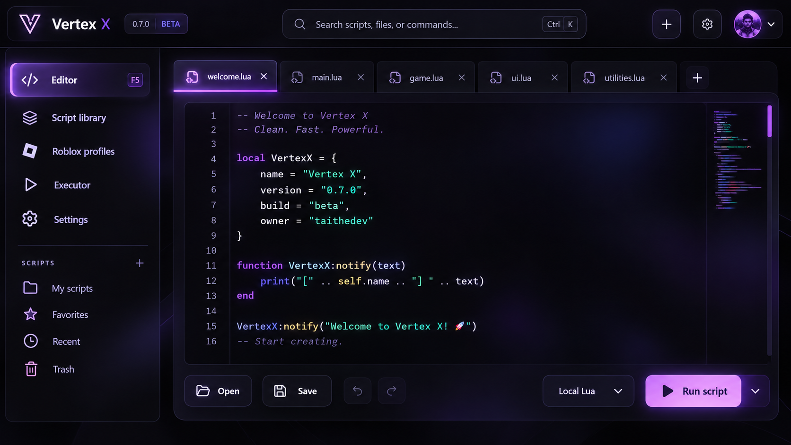

# Vertex X

A Windows Lua workspace with a React interface and a native C# / WPF host. Current version: **0.8.0 beta**.

## Tuff UI



*A concept showcase of the Vertex X interface, featuring the dark editor, purple accents, and soft bloom lighting.*


## New in 0.8.0

- Shared public/private script uploads, source inspection, profiles, avatars and verified badges.
- Server-owned crystals: 100 starter crystals, 20 daily UTC crystals and one crystal per successful run. Failures and cancelled runs cost zero; owners run free.
- Owner verification, crystal grants and moderation, enforced by the backend.
- Realtime account, library and wallet updates, cloud preferences and refreshable memory-only sessions.

## Appearance and editor


- Eight full dark themes and eight accents with live preview, save/revert and reset controls.
- Five backgrounds: aurora, particles, moving grid, stars and waves. Mouse glow, trail and click ripples are optional; intensity and animation controls respect reduced motion and pause when the app is hidden.
- Searchable local script library with sort controls, import/open, refresh and a named Save current script action. Existing library files are never silently overwritten.
- Ctrl+Tab / Ctrl+Shift+Tab cycling, unique untitled tabs, focus restoration, Tab/Shift+Tab indentation and snippet Tab stops.
- Bounded cloud Lua console output, Ctrl+Enter to run selected code, Shift+F5 to stop, source locations in Lua errors and duplicate-run protection.
- Setup creates Desktop and Start menu shortcuts. Preferences can recreate the Desktop shortcut.

Public Roblox avatars/profile details and the Windows Game Bar FPS helper remain available. For FPS without Studio, open Roblox, press Win + G, choose Performance → FPS and pin the widget. Vertex X runs ordinary Lua in an authenticated cloud sandbox; Roblox game APIs require the Roblox runtime. It does not inject scripts into Roblox.

## Workspace

- Dark editor-focused React UI with a searchable script explorer, starter snippets and a command palette.
- CodeMirror editor: Lua syntax highlighting, line numbers, folding, bracket matching, undo/redo and find/replace.
- Recoverable tabs and save/discard/cancel prompts. Recovery is stored in the app's local WebView2 profile; save important scripts to disk.
- Native file dialogs, Save As, and scripts under `Documents/Vertex X/Scripts`.
- Authenticated server Lua execution with Stop, instruction/time limits, a 100 KB source limit and bounded output. OS, filesystem, network, package, debug and coroutine libraries are unavailable; pcall/xpcall are supported.
- Font size, wrap, accent color and auto-update preferences.
- Existing Supabase email/password accounts with usernames; tokens remain in memory and all app tables use the `vertexx_` prefix.
- Public Roblox profile lookup and optional ownership linking using a temporary bio code, with embedded avatars. No Roblox passwords or cookies are requested.

## Build the Windows installer

Run `Build-VertexX.cmd` on Windows. The builder installs missing .NET 8 SDK, Node.js LTS and NSIS prerequisites through winget, installs locked npm dependencies, builds React, runs the account/update/runtime/profile/library checks, publishes the self-contained Windows application, and packages it with NSIS.

Output: `installer-output/VertexX-Setup-0.8.0-x64.exe` and `SHA256SUMS.txt`.

The app uses Microsoft WebView2 to render bundled React assets. Setup detects the runtime and installs Microsoft's signed Evergreen bootstrapper when needed. This prerequisite needs internet if WebView2 is not installed. The Windows builder verifies the bootstrapper's Microsoft Authenticode signature. No separate .NET runtime installation is required.

Setup is per-user and includes Start menu/desktop shortcuts and an uninstaller. Scripts, preferences and recovery data are preserved during upgrades and uninstall. The WebView2 runtime is shared with other apps and is not removed by Vertex X uninstall.

## Updates and releases

Run `Publish-VertexX-Release.cmd` after signing in to GitHub CLI. No GitHub Actions are used. Publication uploads the installer and checksum as a draft before publishing a beta release, tagging the exact clean source commit used for the build.

Vertex X checks complete published releases, including betas, at startup and every 15 minutes, hour or four hours (configurable) when automatic updates are enabled. Downloads are restricted to the official repository and verified against SHA-256 checksums. The update installs only after the app exits following unsaved-edit prompts. Open **Updates** to check manually or view the actual release status. Source commits alone do not create a release.

## Development and verification

React: `cd frontend`, `npm ci`, `npm run build`. `npm run dev` previews the interface; native-only actions clearly report that the installed app is needed. Run `npm run test:ui` after installing Playwright Chromium (`npx playwright install chromium`) for controlled-host browser contract checks. `BROWSER_EXECUTABLE` can select an installed browser. These checks do not execute the Windows host.

React assets are bundled offline under `ui/` by the .NET project. The renderer uses a narrow JSON command bridge; remote navigation, popups, generic shell commands and remote scripts are disabled.

Run the platform-independent native checks:

```
dotnet run --project tests/VertexX.AuthChecks
dotnet run --project tests/VertexX.UpdateChecks
dotnet run --project tests/VertexX.RuntimeChecks
dotnet run --project tests/VertexX.RobloxChecks
dotnet run --project tests/VertexX.LibraryChecks
```

The WPF application can be cross-compiled on Linux with `-p:EnableWindowsTargeting=true -p:PublishSingleFile=false` after building React. Windows install, WebView2 initialization, dialogs, real account login, update installation and uninstall still require native Windows testing. A passing cross-build or a browser test with a controlled host does not replace those checks. The installer is unsigned.

The cloud interpreter uses instruction and allocation guards plus the hosting platform limits. It is not a separate process per script and is not compatible with all desktop Lua libraries.

See [integration details](docs/INTEGRATIONS.md) and [release notes](docs/RELEASE_NOTES_0.8.0.md).
